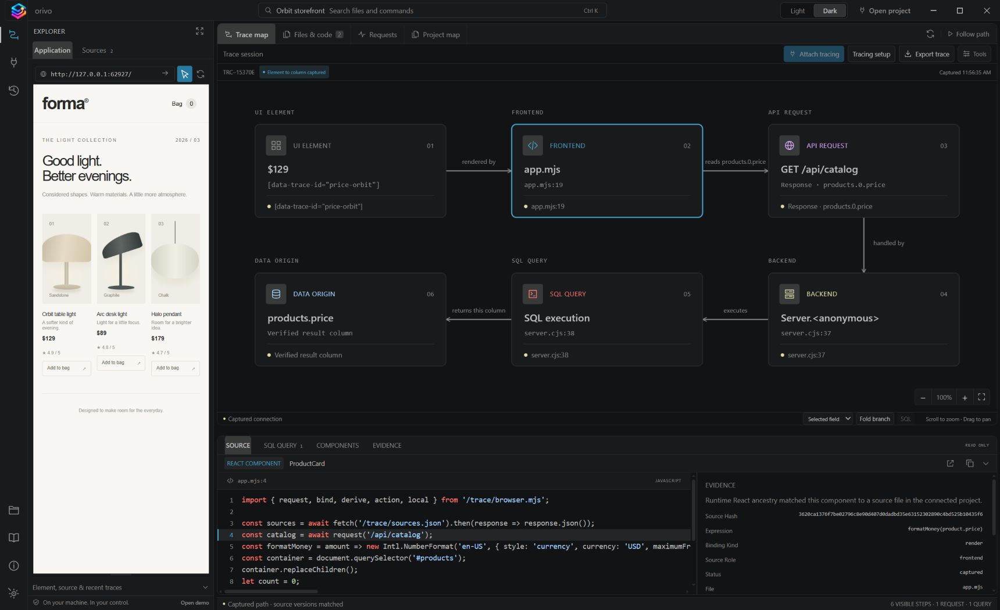
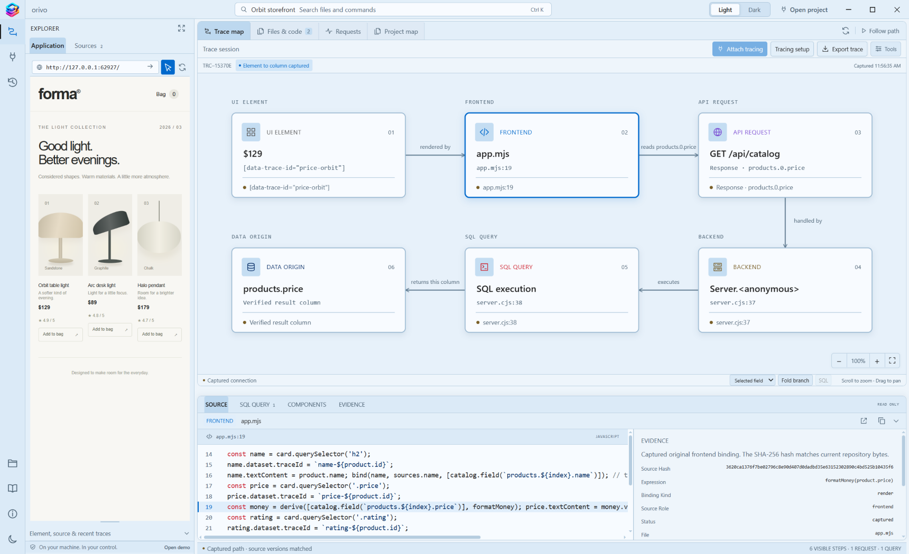
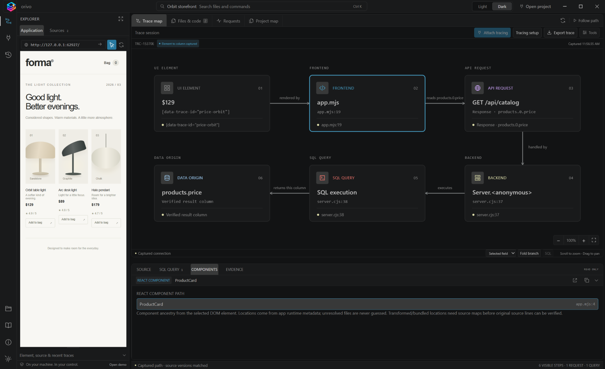
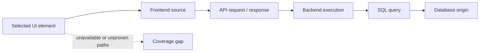

# Orivo

> **See where it starts.**

**Orivo is a Windows desktop tool that lets developers trace a visible UI value back through the application that produced it.** Select an element in a running local app, then inspect the captured path to its frontend source, API request, backend execution, SQL query, and—where evidence permits—database field.

Every connection is backed by captured runtime evidence. When Orivo cannot prove a connection, it shows the gap instead of guessing.

**Version:** 0.1.0 &nbsp;·&nbsp; **Platform:** Windows desktop &nbsp;·&nbsp; **Runtime:** Node.js 24.13+

> [!CAUTION]
> **Development only.** Use Orivo only with local development projects. Do not use it with production applications or production data.

---

## Watch the demo

[▶ Play the one-minute Orivo demo](https://dmgiri.github.io/orivo/) &nbsp;·&nbsp; [Watch on YouTube](https://www.youtube.com/watch?v=WrPwzjOSBgs)

## See Orivo in action

The screenshots below are captured from Orivo’s local demo trace, which follows a selected product price through the frontend, request, backend, SQL execution, and verified database column.



<p align="center">
  
  
</p>

## What Orivo helps you answer

| Question | What Orivo shows |
| --- | --- |
| Where did this on-screen value come from? | The component, file, source location, and selected element context. |
| Which request supplied it? | The observed request and response-field path. |
| What ran on the backend? | The correlated server execution and verified source location. |
| Which query produced it? | Captured SQL and, for supported direct mappings, database-field origin. |
| What is missing? | Explicit coverage gaps instead of inferred links. |

## Quick start

Install [Node.js 24.13 or newer](https://nodejs.org/), then run the following from this repository:

```powershell
npm.cmd ci
npm.cmd start
```

After dependencies are installed, you can also launch Orivo by double-clicking **Start Orivo.cmd**.

## Trace a running application

1. Open Orivo and choose **Open project**.
2. Select your application’s source folder.
3. Enter its local development URL, then choose **Attach tracing**.
4. Wait for the traced session to become ready. If the frontend port is in use, stop that frontend and retry, or enter a separate tracing URL.
5. Choose **Select an element**, then click a visible value in the preview.
6. Follow its route in **Trace map** and inspect the supporting details in **Files & code**, **Requests**, and the **Source / SQL query / Evidence** panel.
7. Check **Coverage details** for missing evidence. Use **Export trace** to save the capture and **Stop session** when you are finished.



Your application must already have its own dependencies, environment, and database available. Opening an existing URL does not instrument its backend. Managed attachment starts supported development processes but does not stop unrelated servers.

## Capabilities

- Trace captured frontend, backend, query, and field-origin connections in one visual map.
- Inspect verified source locations and navigate the connected project’s code.
- Correlate rendered values with response fields, requests, server execution, and SQL evidence.
- Save project connections and export captured trace evidence.
- Use a compact desktop workbench with Light / Dark appearance and resizable panes.
- Open Archify diagram tools from the command palette with **View: diagrams and Archify tools**. Diagrams describe structure; they do not create trace evidence.

## Supported tracing

Orivo currently supports selected development paths—not every framework or data layer.

| Area | Supported paths |
| --- | --- |
| Frontend | Managed React / Vite 5–8, selected Next.js 16 Webpack client paths, and explicit browser bindings |
| Browser requests | Same-origin `fetch` and supported Axios response tracking |
| Backend | Managed FastAPI / Starlette and direct Node HTTP / Express-compatible entries |
| Database | SQLAlchemy, psycopg, SQLite, and selected direct Node database paths |
| Field origin | Direct mappings and selected observed transformations |

For integration steps, evidence produced by each adapter, and exact version constraints, read the [tracing adapter reference](adapters/tracing/README.md).

## Evidence limitations

Orivo traces what actually executes; it does not reconstruct an application statically or infer unobserved paths.

- A trace cannot prove code paths, requests, queries, or database origins that did not run during the session.
- Custom serializers, validators, unsupported transformations, cross-origin dependencies, closed shadow roots, and canvas content can interrupt a trace.
- A captured SQL query alone does not prove which database column supplied a UI value. Field origin requires supported, observed mappings.
- Source changes after a capture can invalidate its evidence. Use **Coverage details** to understand gaps in the selected trace.
- Automatic support is not universal. Frameworks and drivers outside the supported adapters—including Spring Boot and Angular—require compatible instrumentation.
- Project indexing is bounded: the Standard profile scans up to 5,000 files / 40 MiB / 256 KiB per file; the Large profile raises this to 25,000 files / 256 MiB / 1 MiB per file.

See [coverage and limitations](docs/TRACING-COVERAGE.md) for the complete scope and bounds.

## Privacy and local data

Orivo keeps development settings and owned caches in `.tmp/user-data`; launcher logs are stored in `.tmp/launcher`. Source inspection is read-only by default. Applying reviewed manual tracing setup can add integration files to the connected application.

Trace exports can include source and query metadata, so review them before sharing. Values, request bodies, cookies, and database credentials are unnecessary for the trace graph.

## Optional AI

AI Explain is not available in version 0.1.0, and related controls are not shown. Optional model and runtime assets are not included; normal tracing works without AI.

## Documentation

- [Coverage and limitations](docs/TRACING-COVERAGE.md) — supported evidence and known bounds
- [Demo walkthrough](docs/DEMO.md) — run the bundled storefront and trace a complete value path
- [Connect a project and configure tracing](docs/CONNECTING-A-PROJECT.md) — attach a local app, review setup, and capture your first trace
- [Developer setup and checks](docs/DEVELOPMENT.md) — local development and packaging notes
- [Architecture](docs/ARCHITECTURE.md) — application structure and security boundaries
- [Tracing adapter reference](adapters/tracing/README.md) — adapter setup and evidence semantics
- [Third-party notices](THIRD_PARTY_NOTICES.md)

## License

Released under the [MIT License](LICENSE).
