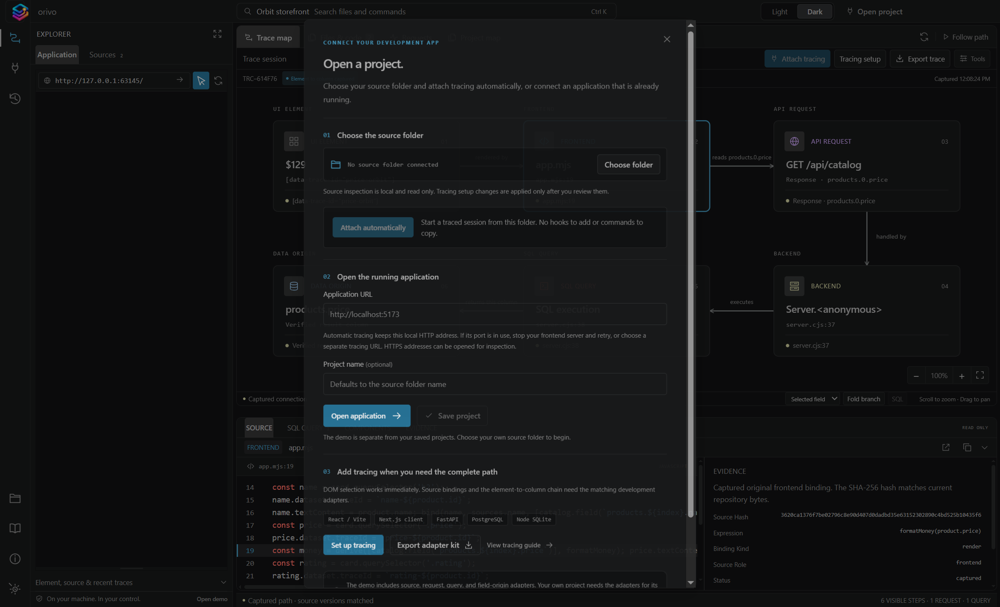
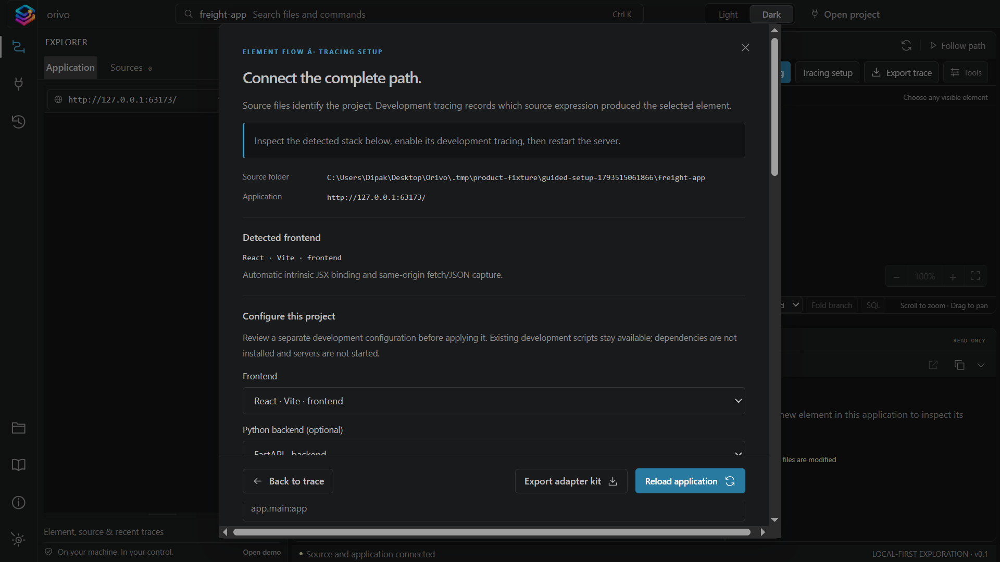
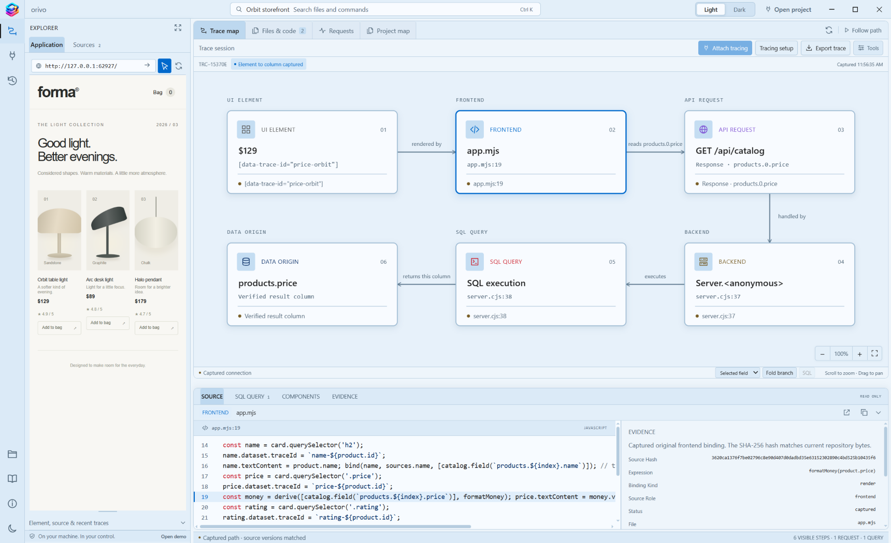

# Connect and trace a new project

This guide shows how to connect your own local development project to Orivo, configure development tracing when needed, and capture your first evidence-backed path.

> Keep tracing in development. Do not enable the adapters in production or expose their development endpoints to untrusted users.

## Before you begin

Have the following ready:

- Your application’s source folder.
- Its working local development environment, including required dependencies, configuration, and database.
- The local URL you want to inspect, such as `http://localhost:5173`.

Orivo reads your project source locally. Opening a URL by itself can inspect the page, but a complete route to backend, SQL, or database evidence requires a compatible tracing adapter.

## 1. Connect the source folder and application

1. Open Orivo and choose **Open project**.
2. Under **Choose the source folder**, choose your application’s root folder.
3. Choose one connection method:

   - **Attach automatically** — let Orivo detect a supported development process and start an owned traced session.
   - **Open application** — enter the address of an application you already started yourself, then choose **Open application**.
4. Optionally give the saved project a name. Choose **Save project** after the source folder and application are both connected.

Source inspection is read-only. Managed attachment starts only processes that Orivo owns; it does not stop unrelated development servers.

## 2. Choose the right tracing path

### Automatic attachment

Use **Attach automatically** when Orivo detects a supported development stack. Orivo starts an isolated traced development session using your existing local project environment. Your application’s dependencies and database still need to be usable.

### An application that is already running

Use **Open application** when you want to inspect a local URL you started yourself. You can select DOM elements immediately, but backend and data-origin evidence appears only when the app has the compatible development adapters enabled.

### Reviewed manual setup

Choose **Set up tracing** from the project dialog or **Tracing setup** from the toolbar when you need to add a development integration. Orivo detects eligible frontend and backend directories and presents the configuration before changing anything.

For an eligible React/Vite project, reviewed setup can add a separate `.studio-tracing` configuration and a `dev:studio` development command while preserving your existing script. For a FastAPI backend, it can create a separate development entry with the app, engine, and session references you provide.

1. Select the detected frontend and optional Python backend.
2. For FastAPI, enter the import references for the app, SQLAlchemy engine, and session factory. Use an app factory when appropriate.
3. Choose **Preview setup changes** and review every generated file and command.
4. Choose **Apply reviewed setup** only if the preview is correct.
5. Start the generated development command yourself, then return to Orivo and open its local URL.

Reviewed setup does not install dependencies or run generated commands. If Orivo finds an existing tracing configuration, it shows activation guidance instead of adding a duplicate setup. You can remove unchanged generated setup later; modified generated files are kept for review.

## 3. Capture your first trace

1. Wait for the application preview to become ready.
2. Choose **Select an element**.
3. Click a visible value in the application preview.
4. Read the resulting **Trace map** and open cards to inspect the source, request, backend, SQL, and field-origin evidence.
5. Open **Coverage details** whenever a stage is absent. A missing stage is a reported gap, not an inferred connection.

## What the coverage badge means

| Badge or result | Meaning |
| --- | --- |
| **Element to column captured** | Orivo observed and verified a complete supported path to a result column. |
| **Frontend source captured** | The UI element maps to verified frontend source, but no matching API/SQL dependency was captured. |
| **Element selected** | Orivo can identify the selected element, but it has no supported binding or the evidence is stale. |
| **Coverage gap** | A required adapter, executed behavior, source version, or supported transformation is missing. |

## Troubleshooting

### The app does not become ready

Confirm the local URL opens in a browser and that the application’s dependencies, environment variables, and database are available. If the frontend port is already occupied, stop that frontend and retry, or choose a separate tracing URL.

### I can select an element but only see frontend evidence

This is expected when the selected value has no observed request path, the backend adapter is not active, or the value went through an unsupported transformation. Check **Coverage details**, then follow the adapter-specific instructions for your stack.

### A source location is missing or stale

Source hashes bind evidence to the source version captured at runtime. Restart the traced development session, refresh the connected repository, and reload the application after source edits.

### My framework is not listed

Orivo does not provide universal automatic tracing. Use an advanced manual adapter where available, or treat the unavailable stages as explicit coverage gaps. See [Tracing coverage](TRACING-COVERAGE.md) and the [tracing adapter reference](../adapters/tracing/README.md).

## Next steps

- Use the [demo walkthrough](DEMO.md) to see a complete bundled trace first.
- Read [coverage and limitations](TRACING-COVERAGE.md) before relying on a capture.
- Consult the [tracing adapter reference](../adapters/tracing/README.md) for framework-specific setup.
