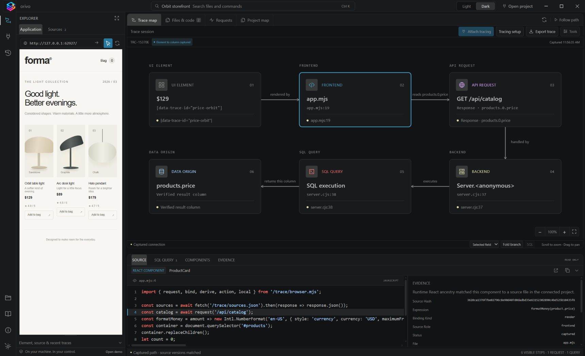
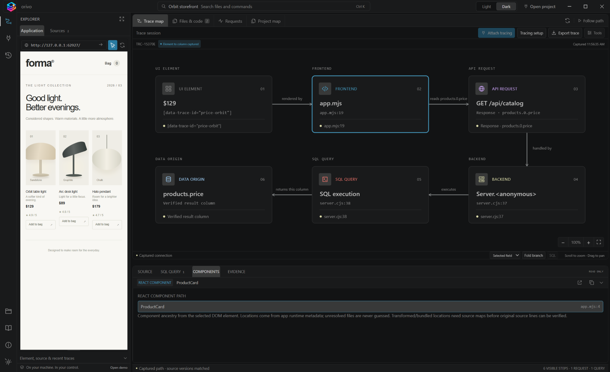

# Orivo demo — how to trace a value

The built-in demo is the fastest way to see Orivo’s evidence model without connecting another project. It runs a local storefront backed by Node.js and SQLite; nothing is uploaded and no account is required.

## What the demo includes

The **Orbit storefront** renders product data returned by `GET /api/catalog`. The demo connects the displayed product price to all of the following:

```text
Selected price → frontend source → HTTP response field → backend execution → SQL query → products.price
```

The same demo also includes frontend-only and action examples so you can see how Orivo presents partial evidence rather than filling gaps with guesses.

## Start the demo

1. Start Orivo from the project root:

   ```powershell
   npm.cmd start
   ```

2. Choose **Explore a working demo** from the welcome screen. You can also choose **Open demo** at the bottom of the Explorer.
3. Wait for the preview to load and for the status badge to show **Element to column captured**.

Orivo starts and stops this local demo for you. The demo is separate from saved projects, and its source is not modified.

## Trace the complete path

1. Choose **Select an element**.
2. In the storefront preview, click the **$129** price for **Orbit table light**.
3. Read the **Trace map** from left to right. The selected UI element connects to:

   1. `app.mjs` — the frontend expression that formats the price.
   2. `GET /api/catalog` — the observed request and response field.
   3. `server.cjs` — the backend handler.
   4. `SQL execution` — the query that returned the product record.
   5. `products.price` — the verified database result column.

4. Click any card in the map to open its supporting source, SQL, or evidence in the lower inspector.



## Inspect the evidence

After selecting the price, use these views to understand why each connection exists:

| View | Try this |
| --- | --- |
| **Files & code** | Open `app.mjs` to see the rendered price expression and `server.cjs` to see the API handler. |
| **Requests** | Select `GET /api/catalog` to inspect the observed response field path. |
| **SQL query** | Select the SQL card or inspector tab to see the executed statement. |
| **Evidence** | Review source hashes, binding type, and capture status. |
| **Components** | Select the component inspector to view captured React ancestry when the runtime exposes development metadata. |



## Explore other kinds of paths

## Investigate a broken price

Choose **Investigate a broken price**. The Orbit item visibly renders as **$12,900** instead of `$129`. Select it and follow the trace to `server.cjs`: an intentionally incorrect cents conversion multiplies the database value by 100 before it reaches the frontend. SQL evidence still identifies `products.price` as the original field.

Orivo does not diagnose the defect automatically; it presents the captured evidence needed to verify the cause.

### Frontend-only value

Select the storefront footer text, **Designed to make room for the everyday.** It is intentionally marked as a frontend-only/static value, so no request, backend, SQL, or database-column claim is shown.

### Another data field

Select a product name, such as **Orbit table light**. Compare its route with the price trace to see how the response and data-origin field change.

### User action

Exit selection mode, click **Add to bag** for a product, then select that button. The demo records the action’s observed request only after the user performs it; selecting an element never triggers the action itself.

## Reset or finish

- Choose **Refresh trace** to capture the selected element again.
- Choose **Export trace** to save the evidence as a local file; review exports before sharing because they can include source and query metadata.
- Choose **Stop session** when you are finished. Orivo stops the demo processes it owns and leaves unrelated local servers alone.

## Next step: trace your own project

Choose **Open project**, select your application’s source folder, enter its local development URL, and use **Attach tracing**. Your project needs compatible adapters for its stack; unsupported stages stay visible as coverage gaps. See [Tracing coverage](TRACING-COVERAGE.md) and the [tracing adapter reference](../adapters/tracing/README.md) before making a coverage claim.
